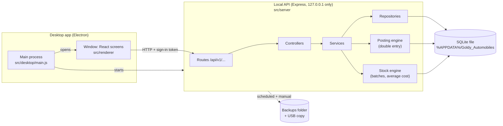

# GOLDY AUTOMOBILE ERP — architecture and system design

This document explains how the app is built and how its parts work together.
For every file and every function in it, see the
[file reference](file-reference.md) (generated from the code).

## 1. What the app is

An offline Windows desktop app that runs a car repair workshop in place of
Tally. One person (the owner) uses it on one laptop, with about six
mechanics and six cars a day. It covers:

- **Workshop:** job cards from intake to bill, mechanics, the workshop queue,
  service reminders and service history.
- **Selling:** GST tax invoices for job cards, counter sales without a job
  card, returns and warranties.
- **Stock:** items, batches, godowns, supplier bills, weighted average cost,
  counts, moves and adjustments.
- **Money:** cash and bank accounts, customer and supplier payments, refunds,
  expenses, staff salary and advances, dues and the daily cash count.
- **Accounts and GST:** a full double-entry ledger, trial balance, profit and
  loss, balance sheet, GSTR-1 files, GSTR-3B and HSN figures, and a Tally file
  for the CA.
- **Safety:** automatic and manual backups, USB copies, restore, integrity
  checks and an audit log of every change.

Everything is stored in one SQLite file on the laptop. Nothing leaves the
laptop.

## 2. Architecture at a glance

| Part               | Technology                                                               | Where                                 |
| ------------------ | ------------------------------------------------------------------------ | ------------------------------------- |
| Desktop shell      | Electron 44                                                              | `src/desktop`                         |
| Screens            | React 18, React Router (hash), TanStack Query, Tailwind, Chart.js        | `src/renderer`                        |
| Local API          | Node.js + Express 4                                                      | `src/server`                          |
| Database           | SQLite (better-sqlite3), WAL mode                                        | `src/server/database`                 |
| Printable job card | Plain HTML + JS page                                                     | `public/print-job-card.*`             |
| Tests              | Node test runner (backend), Vitest + jsdom (screens), Electron smoke run | `tests`, `src/desktop/smoke-check.js` |
| Packaging          | electron-builder (Windows installer)                                     | `electron-builder.json5`              |

## 3. Runtime: start, run, stop

1. **Start.** `src/desktop/main.js` makes sure only one copy runs, then calls
   `startServer()` from `src/server/server.js`.
2. **Database checks.** `connection.js` opens the SQLite file:
   - It waits for a busy file, turns on foreign keys and WAL, and runs
     `integrity_check`.
   - If the file is damaged, `corruption-recovery-service.js` keeps the
     damaged copy and restores the newest good backup.
3. **Migrations and seeds.** `migration-service.js` takes a safety backup,
   then applies new numbered migrations (`database/migrations/NNN_*.sql`),
   each in its own transaction. Edited or duplicate migration files are
   refused (checksums). Seeds add roles, permissions, the chart of accounts,
   godowns, categories and the starter parts catalogue.
4. **API and scheduler.** The Express API listens on 127.0.0.1 only, and the
   backup scheduler starts: a daily backup, plus catch-up if the laptop was off.
5. **Window.** The window loads the React screens from the same local server.
   The first run asks for an administrator account and shows a one-time
   recovery code.
6. **Stop.** On close, the app offers "Copy backup to USB and close". It then
   stops the scheduler, closes the HTTP listener and closes SQLite.

## 4. Layers and rules (server)

Each feature module in `src/server/modules/<feature>/` has the same layers:

| Layer             | Job                                                                    |
| ----------------- | ---------------------------------------------------------------------- |
| `*.routes.js`     | URL, sign-in check, permission check (`requirePermission`).            |
| `*.controller.js` | Reads the request, calls the service, sends JSON.                      |
| `*.service.js`    | Business rules, validation, one transaction per action, audit records. |
| `*.repository.js` | SQL queries only.                                                      |

Rules that hold everywhere:

- **Money is always double entry.** Every money movement goes through
  `AccountingPostingEngine.post()`:
  - Debits must equal credits.
  - The date must be in an open financial year (April to March).
  - Receipt, payment and contra vouchers must touch cash or a bank.
  - A wrong voucher is reversed, never deleted (`deleteVoucher` posts the
    opposite entries and marks it cancelled).
- **Stock and money change together.** Each action runs in one SQLite
  transaction: a bill, supplier bill, return, adjustment, count approval,
  warranty replacement or opening stock changes the stock and posts its
  voucher at the same time. If any step fails, nothing is saved.
- **Weighted average cost.** `stockIn` recalculates an item's average cost;
  `stockOut` takes stock at that cost. Profit is selling price minus that cost.
- **Cancelling reverses everything.**
  - A cancelled bill puts stock back and reverses sales, cost and profit.
  - Money already paid stays with the customer as an advance, which can be
    refunded from Money In / Out.
- **Audit log.** Creates, edits, cancels, refunds, salary payments and
  restores write an audit record with old and new values.
- **Plain errors.** Services throw `AppError(message, status, code)`. The
  message is written for the owner and shown on screen.

## 5. Data design

91 tables, created by 46 migrations. The main groups:

| Group             | Main tables                                                                                                                                                                                                                |
| ----------------- | -------------------------------------------------------------------------------------------------------------------------------------------------------------------------------------------------------------------------- |
| People            | `users`, `roles`, `permissions`, `role_permissions`, `user_sessions`, `technicians`, `staff_payments`                                                                                                                      |
| Customers & cars  | `customers`, `vehicles`, `service_reminders`                                                                                                                                                                               |
| Workshop          | `job_cards`, `job_card_items` (parts), `job_card_labour`, `estimate_approvals`, `mechanic_time_entries`                                                                                                                    |
| Bills             | `invoices`, `invoice_items`, `profit_records`, `direct_invoices` (counter sales), `direct_invoice_items`                                                                                                                   |
| Stock             | `inventory_items`, `inventory_batches`, `inventory_transactions`, `warehouses`, `stock_adjustments`, `stock_transfers`, `stock_verifications`, `fixed_assets`                                                              |
| Buying            | `suppliers`, `purchase_orders`, `purchase_receipts` (supplier bills), `purchase_items`, `supplier_ledgers`                                                                                                                 |
| Returns/warranty  | `customer_returns`, `supplier_returns` (+ items), `warranty_registrations`, `warranty_claims`                                                                                                                              |
| Accounts          | `ledgers`, `account_groups`, `vouchers`, `journal_entries`, `ledger_balances`, `financial_years`, `customer_receipts`, `receipt_allocations`, `supplier_payments`, `supplier_allocations`, `expenses`, `daily_cash_counts` |
| Numbering         | `document_sequences` (one counter per series and financial year), voucher number counters                                                                                                                                  |
| Settings & safety | `system_settings`, `companies`, `backup_logs`, `restore_logs`, `audit_logs`, `schema_migrations`                                                                                                                           |

**Document numbers.** These come from `shared/utils/document-number.js`:
`SERIES/26-27/0001`, consecutive per financial year and at most 16
characters, as GST Rule 46 requires for invoices.

| Series | Document                       | Series | Document                      |
| ------ | ------------------------------ | ------ | ----------------------------- |
| INV    | Job card tax invoice           | CS     | Counter sale invoice          |
| JC     | Job card                       | CN     | Credit note (customer return) |
| DN     | Debit note (supplier return)   | PO     | Purchase order                |
| GRN    | Supplier bill without a number | WC     | Warranty claim                |
| SC     | Stock count                    | MV     | Godown move                   |
| ADJ    | Stock adjustment               | OPN    | Opening stock                 |

Vouchers have their own numbers (SAL-, PUR-, REC-, PAY-, JRN- with the year).

**Ledgers.** System ledgers have a fixed `system_key`:

- `cash_in_hand` and banks (`hdfc_bank`, `bank_N`)
- `inventory_stock`
- `cgst_output` / `sgst_output` / `igst_output` and the matching `_input`
- `capital_account`, `salary_expense`, `staff_advances`, `round_off`

Each customer and supplier gets its own ledger the first time it is used.
What a customer owes, or has paid in advance, is the balance of their ledger.

**Supplier Ledger screen.** It reads `supplier_ledgers`: a running list of
bills, payments and returns, written in the same transaction as each voucher
by `purchasing/supplier-ledger.js`.

**Payments and bills.** A customer receipt is matched to bills through
`receipt_allocations`. A payment taken while billing pays that bill; a
payment from Money In pays the oldest bills first. Any unmatched part is the
customer's advance.

## 6. Main flows

### Job card to bill

1. Job Cards → Create Job Card. The phone number finds or creates the
   customer, and the car number finds or creates the car
   (`use-intake-lookup.js`, `job-card.service.create`).
2. Add parts (a batch with stock is picked automatically) and labour. The
   running total updates on screen.
3. Make bill → choose Pay later, Cash, UPI or Card. `finalize()` runs in one
   transaction:
   - takes the next INV number;
   - takes stock out at average cost;
   - splits GST (CGST+SGST in Haryana, IGST for other states);
   - saves the profit record;
   - posts the sales voucher and the cost-of-goods voucher;
   - registers part warranties.
4. If paid now, the screen records a receipt that pays this bill.
5. Bills → Print gives the GST tax invoice: Rule 46 fields, amount in words,
   tax summary. The internal profit line is hidden when printed.

### Counter sale

Counter Sale → New counter sale. Choose a customer or leave it as walk-in,
then the items (price and GST come from the item; stock comes from the godown
holding it) and the payment. `direct-billing.service` makes the CS bill and
its vouchers. Cancel puts stock back and keeps any payment as advance.

### Buying stock

Buy Stock → Enter supplier bill. Each line adds stock to a batch. The batch
number is optional and defaults to the bill number. The bill also:

- applies a new selling price if one was typed;
- posts the purchase voucher with input GST;
- adds the bill to the Supplier Ledger.

Paying the supplier (Money Out) and sending parts back (Returns) both lower
what is owed on that ledger.

### Money In / Out

- **Plain choices:**
  - a customer paid me;
  - I paid a supplier;
  - I gave money back to a customer (never more than their advance);
  - owner's money in or out;
  - loans;
  - other income or expense.
- **Last entries** lists recent cash and bank movements, each with Cancel:
  - customer and supplier payments are unmatched from their bills;
  - salary and advances are removed from Staff & Salary;
  - refunds give the advance back;
  - bills, counter sales, expenses and stock entries say which screen to
    cancel them on.
- **Starting balances** brings in cash, banks and customer and supplier dues
  from old books, against capital.

### Returns and warranties

- **Customer return.** Credit note CN/... Good parts go back to stock and
  damaged ones are written off. GST and profit are reversed and the
  customer's bill is reduced.
- **Supplier return.** Debit note DN/..., created from a supplier bill line.
  Stock goes out, input GST is reversed and the supplier is owed less.
- **Warranty.** A warranty is registered when a part with warranty months is
  billed. A claim can be settled with a replacement from stock (posted as
  warranty expense) or a refund, or it can be rejected.

### Staff & Salary

Set a monthly salary, give advances (posted to Staff Advances) and pay
salary once a month with part of the advance recovered. All of it can be
undone from Last entries, in the right order.

### GST and the CA

Reports & GST:

- five GSTR-1 CSV files (B2B, B2C, credit notes, HSN, documents issued) in
  the offline tool's layout, with dates as 26-Nov-2026;
- GSTR-3B output tax and input tax credit;
- HSN/SAC totals;
- a Tally Prime XML file with every voucher;
- trial balance, profit and loss and balance sheet.

### Backup and restore

- **Automatic backups:** daily, weekly or every N hours, with catch-up when
  the laptop was off.
- **Back up now:** a manual backup from Settings.
- **USB copy:** an optional copy to an external folder.
- Each backup is verified. Only the newest N automatic backups are kept.
- **Home banner:** warns if there is no backup, the last one is older than
  2 days, the last one failed, or the USB copy failed.
- **Restore** (latest, or from a file): checks the file is a Goldy database,
  keeps a pre-restore copy, then swaps the files. The person signs in again
  afterwards.

## 7. Screens map

Everyday menu first, then "More tools". Every screen talks only to
`/api/v1/...` through `shared/api/api-client.js`.

| Menu              | Route                 | Screen component                       | Main API                                                             |
| ----------------- | --------------------- | -------------------------------------- | -------------------------------------------------------------------- |
| Home              | `/`                   | `SalesDashboardContainer`              | `/dashboard/*`, `/backups/health`                                    |
| Job Cards         | `/job-cards`          | `JobCardManager`                       | `/job-cards`, `/inventory/items`, `/accounting/receipts`             |
| Bills             | `/invoices`           | `InvoiceManager`                       | `/invoices`, `/invoices/:id/cancel`                                  |
| Counter Sale      | `/counter-sale`       | `CounterSale`                          | `/accounting/direct-invoices`                                        |
| Customers         | `/customers`          | `CustomerManager`                      | `/customers`                                                         |
| Vehicles          | `/vehicles`           | `VehicleManager`                       | `/vehicles`                                                          |
| Stock             | `/inventory`          | `InventoryManager`                     | `/inventory/*`, `/assets`                                            |
| Buy Stock         | `/purchasing`         | `PurchasingManager`                    | `/purchases/receipts`, `/purchases/orders`                           |
| Suppliers         | `/suppliers`          | `SupplierManager`                      | `/suppliers`                                                         |
| Money In / Out    | `/money`              | `MoneyInOut`                           | `/accounting/money-*`, `/receipts`, `/payments`, `/customer-refunds` |
| Dues & Daily Cash | `/cash-receivables`   | `WorkshopFinance`                      | `/accounting/receivable-ageing`, `/daily-cash`                       |
| Expenses          | `/expenses`           | `ExpenseManager`                       | `/expenses`                                                          |
| Staff & Salary    | `/staff`              | `StaffPay`                             | `/staff-pay`                                                         |
| Reports & GST     | `/reports`            | `ReportsManager`                       | `/gst/*`, `/accounting/reports/*`, `/profit/tally-export`            |
| Settings & Backup | `/settings`           | `SettingsPortal`                       | `/settings/company`, `/backups/*`                                    |
| Workshop Queue    | `/workshop`           | `WorkshopBoard`                        | `/workshop/*`                                                        |
| Service Reminders | `/reminders`          | `ServiceReminders`                     | `/crm/reminders`                                                     |
| Service History   | `/service-history`    | `ServiceHistory`                       | `/vehicles/:id/service-history`                                      |
| Mechanics         | `/technicians`        | `TechnicianManager`                    | `/technicians`                                                       |
| Accounts (Ledger) | `/accounting`         | `AccountingPortal`                     | `/accounting/ledgers`, `/vouchers`, reports                          |
| Supplier Ledger   | `/supplier-ledger`    | `SupplierLedger`                       | `/purchases/suppliers/:id/ledger`                                    |
| Returns           | `/returns`            | `ReturnsManager`, `SupplierReturnForm` | `/returns/customer`, `/returns/supplier`                             |
| Warranties        | `/warranties`         | `WarrantyManager`                      | `/warranties`, `/warranties/claims`                                  |
| Stock Count       | `/stock-verification` | `StockVerificationManager`             | `/inventory/verifications`                                           |
| Godowns & Masters | `/masters`            | `MasterManager`                        | `/warehouses`, `/inventory-categories`, starter catalogue            |
| Fixed Assets      | `/assets`             | `FixedAssetManager`                    | `/inventory/assets`                                                  |
| Audit Log         | `/audit-logs`         | `AuditLogManager`                      | `/audit-logs`                                                        |

Keyboard shortcuts:

- F1 Home, F2 Job Cards, F3 Counter Sale, F4 Stock, F5 Buy Stock, F6 Accounts, F7 Reports, F8 Customers, F9 Settings.
- Ctrl+P opens "Find a screen".

**Screen state.** TanStack Query holds the data loaded from the server and
always refetches when a screen opens (the API is local, so this is instant).
Zustand holds sign-in, theme, notices and confirm dialogs.

## 8. Security and safety

- **Loopback only.** The API listens on 127.0.0.1 and rejects requests for
  any other host name (`local-host-guard.js`), which stops DNS-rebinding
  attacks from web pages.
- **Locked-down window.** The Electron window has no Node access, runs
  sandboxed and isolated, and talks to the API only over HTTP.
- **Sign-in:**
  - passwords are hashed with bcrypt;
  - an account locks for 15 minutes after repeated failures;
  - only the hash of each session token is stored;
  - every route checks a role permission;
  - a recovery code resets a forgotten password.
- **Audit log** of every important change.
- **Data safety:**
  - WAL mode and foreign keys;
  - a busy timeout;
  - an integrity check on every start, with automatic recovery;
  - a backup before every migration;
  - backup and restore locks so the two never overlap;
  - verified backups.
- **Public repository holds code only.** `npm run check:safety` refuses
  databases, backups, `.env` files and secret keys. Tests and screenshots use
  made-up data only.

## 9. Quality checks

- `npm run check` runs:
  - the repository safety check;
  - Prettier and ESLint (no unused code allowed);
  - the backend tests (Node test runner inside Electron, each with its own
    temporary database);
  - the screen tests (Vitest).
- `npm run smoke:desktop` starts the real desktop app with disposable data
  and drives the main flows. The CI on GitHub (`windows-latest`) runs the same
  checks.
- `npm run docs:reference` rewrites
  [file-reference.md](file-reference.md) after files are added or removed. It
  fails if a file has no written purpose.

## 10. What was removed and why (November 2026 review)

These parts had no screen, or were half-built, and were taken out to keep
the app simple and the code honest:

| Removed                                                                                                                                                  | Reason                                                                                                                     |
| -------------------------------------------------------------------------------------------------------------------------------------------------------- | -------------------------------------------------------------------------------------------------------------------------- |
| Sales Orders and quotations                                                                                                                              | Could reserve stock but never bill, deliver or cancel. Replaced by Counter Sale. Migration 048 releases any stock it held. |
| Stock reservations                                                                                                                                       | Only Sales Orders created them.                                                                                            |
| Demo mode and "purge demo"                                                                                                                               | No screen. The old demo database is still opened if that setting is on, so no data is hidden.                              |
| Loyalty points, referrals, promotions                                                                                                                    | No screen; not used by the workshop.                                                                                       |
| Duplicate supplier API and purchase-bill API inside accounting                                                                                           | Suppliers and supplier bills already have their own screens.                                                               |
| Duplicate purchase-return API                                                                                                                            | Supplier returns go through the Returns screen.                                                                            |
| Debug endpoints, restore-by-id, autocomplete, unused report endpoints, GST period locks, warehouse permissions, transfer cancel, two-step godown receive | No screen used them. Moves now complete in one step.                                                                       |
